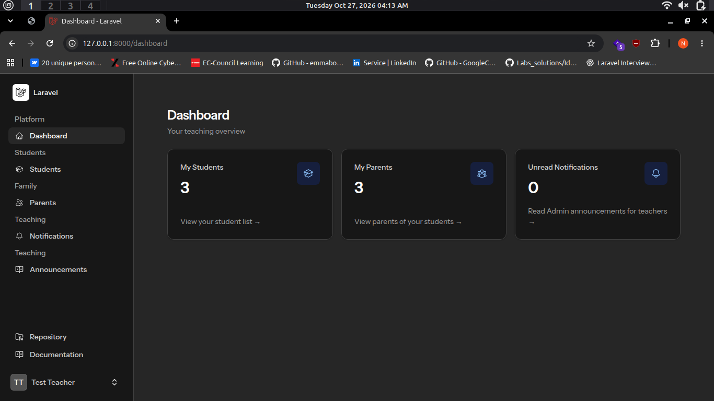
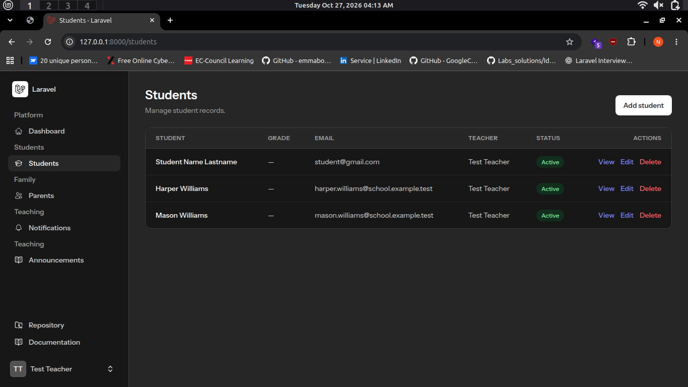
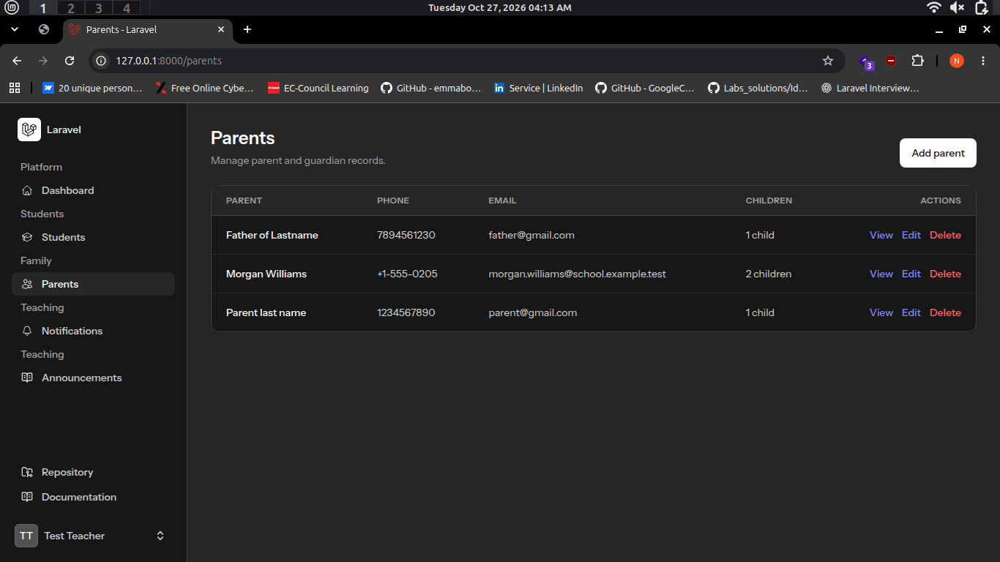
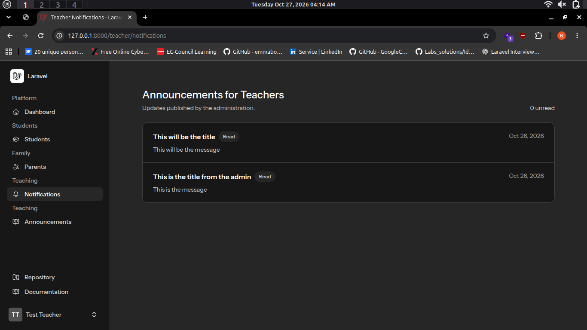

# School Management System

A Laravel school management application with separate Admin and Teacher workflows for managing teachers, students, parents, and announcements.

## Features

### Admin

- Dashboard summaries for teachers, students, and parents.
- Teacher account management and student totals per teacher.
- Student and parent record management.
- Announcements for teachers.

### Teacher

- Dashboard summaries for the teacher's students, associated parents, and unread Admin announcements.
- Student and parent lists scoped to the signed-in teacher.
- Notifications inbox for Admin announcements.
- Announcements addressed to students, parents, or both.

## Requirements

- PHP 8.3 or later
- Composer
- Node.js and npm
- SQLite by default, or another database configured in `.env`

## Local Setup

From the project root:

```bash
composer install
cp .env.example .env
php artisan key:generate
```

The default `.env.example` uses SQLite. Create its database file before migrating:

```bash
touch database/database.sqlite
```

On Windows PowerShell, use:

```powershell
New-Item database/database.sqlite -ItemType File
```

Then create the schema and local demo records, install frontend dependencies, and build the assets:

```bash
php artisan migrate --seed
npm install
npm run build
php artisan storage:link
```

If you use MySQL or another database, configure the `DB_*` values in `.env` instead of creating the SQLite file.

- email:admin@example.com, password:password

## Run the Application

Start the Laravel development server:

```bash
php artisan serve
```

In a second terminal, start Vite for live frontend updates:

```bash
npm run dev
```

The default local URL is `http://localhost:8000`.

### Queue and Mail

The default queue connection is `database`, and the default mailer is `log`. Start a queue worker to process queued announcements and notification jobs:

```bash
php artisan queue:work
```

With the default mailer, generated email output is written to the application log rather than sent externally. Configure the `MAIL_*` values in `.env` to use an email provider.

### Local Seed Login

On a fresh local database seeded with `php artisan db:seed`, the default Admin account is:

- Email: `admin@example.com`
- Password: `password`

The seeders also create Teacher accounts with the password `password`; their email addresses are generated. These credentials are for local development only.

## Tests

Run the automated test suite with:

```bash
php artisan test
```

## Screenshots

The screenshots are stored under `extras/Admin` and `extras/teacher`.

### Admin

<details>
<summary>View Admin screenshots</summary>

#### Dashboard


#### Teachers


#### Announcements


#### Students


#### Parents


</details>

### Teacher

<details>
<summary>View Teacher screenshots</summary>

#### Dashboard



#### Students



#### Parents



#### Notifications



#### Teacher announcements


</details>
